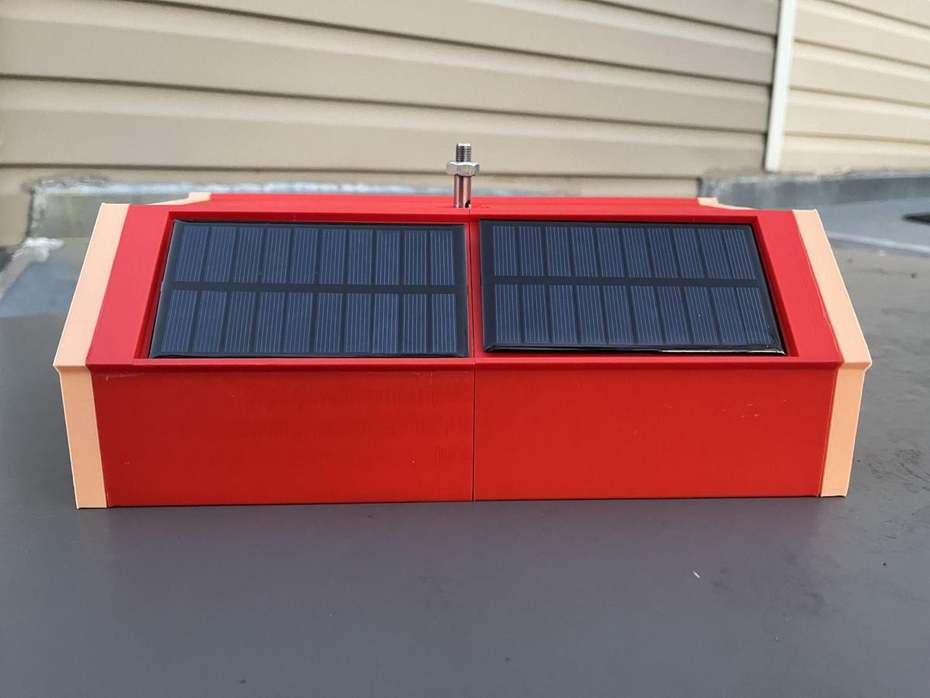
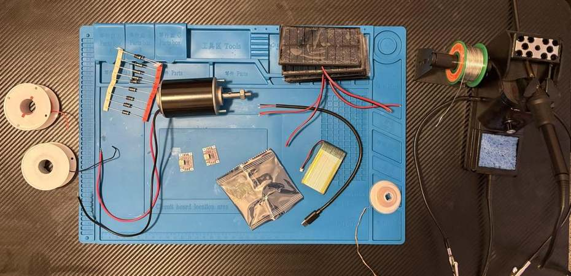
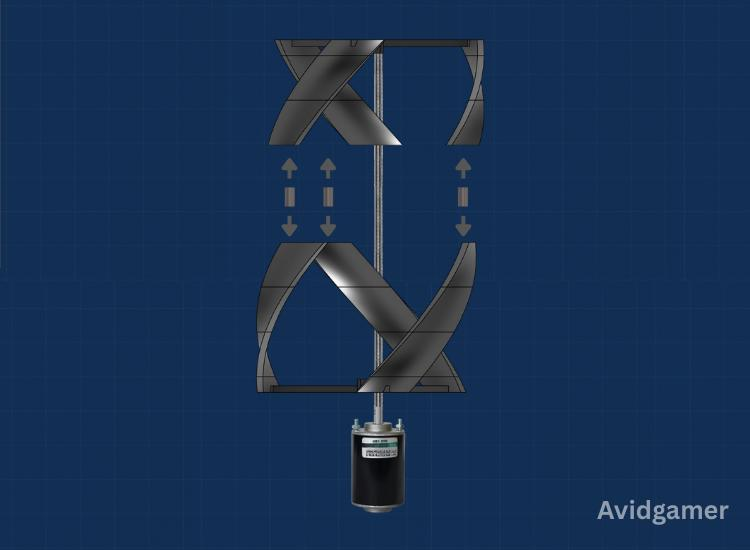
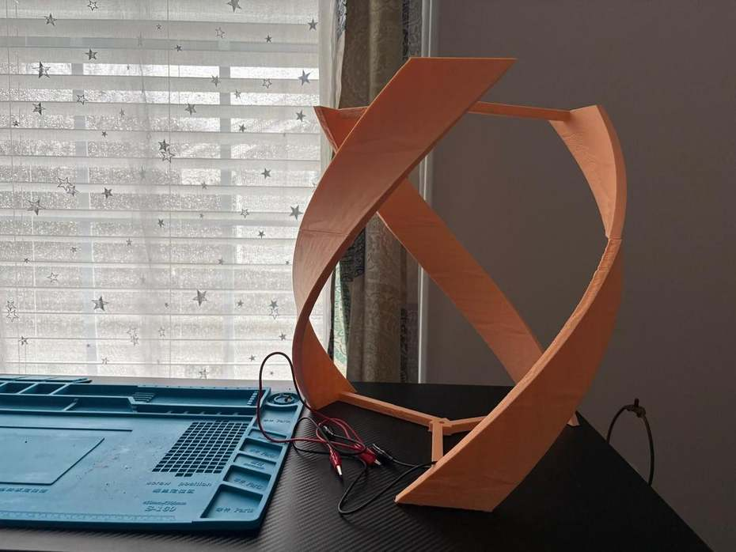
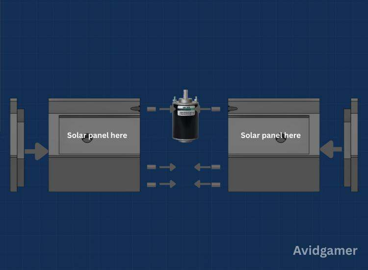
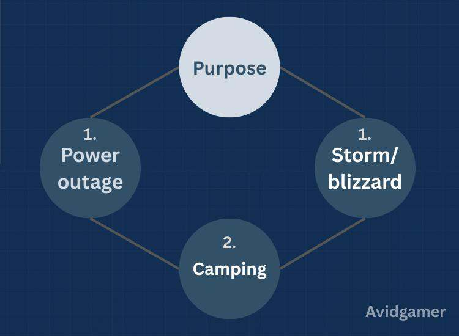

# Portable Hybrid Solar–Wind Generator

I built this portable generator to combine wind and solar power in a small, modular system. It uses a 3D-printed helical vertical-axis wind turbine, four solar panels, and a LiPo battery bank with USB-C output. I designed the parts in Fusion 360 and printed the rotor and enclosure separately so they could be assembled together.

## Parts

- 3D-printed turbine blades, top and bottom supports, pegs, motor mount, and enclosure
- Small DC motor used as a generator
- Four 5 V, 200 mA solar panels
- Two 5 V buck-boost converter modules and Schottky diodes
- LiPo battery with a compatible charging/power-bank board
- USB-C connection, wires, connectors, and mounting hardware

## 1. Print the parts

All of the printable files are in the [3MF folder](3MF%20files/). I've also included the [Fusion 360 files](F3D%20files/) in case you want to change anything.

| Part | Print file |
| --- | --- |
| Full turbine and case | [gorlov+case.3mf](3MF%20files/gorlov%2Bcase.3mf) |
| Rotor base | [gorlovBase.3mf](3MF%20files/gorlovBase.3mf) |
| Helical blades | [gorlovBlades.3mf](3MF%20files/gorlovBlades.3mf) |
| Rotor top | [gorlovTop.3mf](3MF%20files/gorlovTop.3mf) |
| Motor stand | [motorstand.3mf](3MF%20files/motorstand.3mf) |
| Connecting peg | [peg.3mf](3MF%20files/peg.3mf) |

The rotor is approximately 330 mm wide and 350 mm tall in my original sketch. Check the dimensions and fit in your slicer before printing.

## 2. Assemble the wind turbine

The blades fit between the top and bottom supports. I split the rotor into pieces to make printing and assembly easier.

1. Print the blades, top, base, and connecting pegs.
2. Fit the blades into the matching positions on the supports, following the exploded view.
3. Join the rotor sections and check that the blades are lined up.
4. Make sure the assembled rotor spins without rubbing or wobbling.

## 3. Mount the generator and assemble the base

I used a small DC motor as the wind generator. It mounts beneath the rotor with the shaft running through the center. Keep the shaft aligned so the blades can spin freely.

The enclosure is made from two sections that hold the solar panels, with the generator positioned in the middle.

Fit the solar panels into the angled openings on top. Leave enough space inside for the battery bank, converters, and wires, and keep wiring away from the rotating shaft.

## 4. Connect the electronics

I used separate power paths for the wind turbine and solar panels. Both go through their own voltage converter and a Schottky diode before feeding the battery-bank electronics.

- **Solar:** Solar panels → 5 V converter → Schottky diode
- **Wind:** DC generator → 5 V converter → Schottky diode
- **Storage/output:** Combined input → charging/power-bank board → USB-C

The wind generator's voltage varies with RPM, so the converter has to be able to start at the voltage it actually produces. Check polarity and module ratings before connecting the circuit. For the LiPo battery, use a compatible charger with protection circuitry; the power-path outline above isn't a pin-by-pin wiring diagram.

## 5. Final assembly

This image shows the parts coming together, from the separate rotor sections to the completed turbine and base.

1. Position the motor and mount in the middle of the enclosure.
2. Install the solar panels and arrange the electronics inside.
3. Route the wires so they won't be pinched when the enclosure closes.
4. Join the enclosure sections and attach the completed rotor to the motor shaft.
5. Check that everything is secure and the rotor turns freely before testing.

## 6. Testing

I tested the wind side in different wind conditions and got approximate outputs of:

| Wind conditions | Power |
| --- | ---: |
| Low wind | ~0.05 W |
| Moderate wind | ~2.5–3 W |
| Stronger wind | ~3–4 W |

These are approximate early results, not a calibrated power curve. Solar output also depends on lighting and panel orientation. When testing electrical output, measure voltage and current together under a known load rather than using open-circuit voltage alone.
