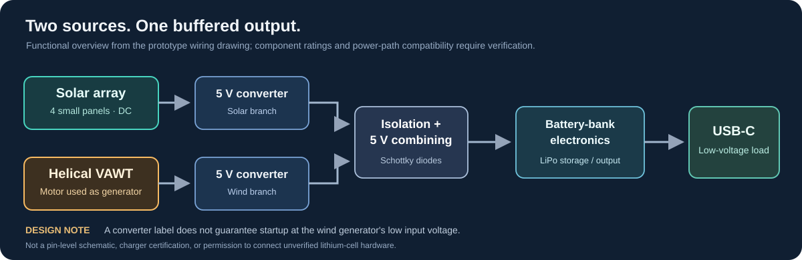

# Portable Hybrid Solar–Wind Energy Harvester

A compact renewable-energy prototype that combines four small solar panels with a modular helical vertical-axis wind turbine. Both sources feed separate voltage-conditioning branches and a shared lithium-battery power-bank section for low-voltage USB output.

The project began with a practical packaging problem: how much renewable generation could fit into an enclosure small enough to carry, with a turbine that could be assembled above it when needed? The result is a 3D-printed Gorlov-style rotor and a solar-panel base designed together in Fusion 360.

[Build article with photographs](https://www.instructables.com/Portable-Hybrid-Rapid-Deploy-Renewable-Generator/) · [Fusion 360 source files](F3D%20files/) · [3MF printing files](3MF%20files/) · [Mechanical design notes](docs/mechanical-design.md) · [Electrical architecture](docs/electrical-architecture.md)

> **Prototype status:** The enclosure and rotor have been fabricated. The design images include mechanical simulations, but the published material is not a certified structural or electrical test report. The approximate output numbers below are preliminary project notes, not a verified power curve.

## The physical design

The system has two main assemblies:

- **Helical wind turbine:** A three-dimensional, twisted-blade vertical-axis rotor mounted above the base. Unlike a horizontal-axis turbine, a VAWT does not need a yaw mechanism to turn toward changing horizontal wind directions. A small DC motor is used as the generator.
- **Solar base:** A split, low-profile printed enclosure with solar panels mounted into the upper faces. The base also accommodates the electronic power-handling components and supports the rotor/generator mount.

The design was split into printable sections to avoid treating the entire rotor as one large object. The CAD files include separate rotor blades, top and bottom parts, a motor stand, pegs, and a combined case assembly.

The earliest dimensioned sketch shows a rotor about **330 mm in diameter** and **350 mm tall**, corresponding to a projected swept area of approximately **0.115 m²**. The enclosure sketch shows **260 mm width** and **100 mm height**. These are sketch annotations; check the final models before using them as fabrication dimensions.

The finished prototype is shown in the [Instructables photo walkthrough](https://www.instructables.com/Portable-Hybrid-Rapid-Deploy-Renewable-Generator/). The supplied build photographs show the printed orange turbine, a red-and-cream solar-panel enclosure, and the motor/electronics before integration.

### Design progression

| Stage | What was developed | Available record |
| --- | --- | --- |
| Sketching | Rotor proportions, swept area, central generator shaft and compact base | Dimensioned hand sketches in the build article |
| CAD | Separate blade and support pieces, enclosure, exploded assembly views | [F3D](F3D%20files/) and [3MF](3MF%20files/) directories |
| Structural exploration | Safety-factor and velocity visualizations of the modeled rotor | Simulation screenshots in the build documentation |
| Prototyping | Printed helical rotor, solar-panel housing and electronics | Photographs in the [build article](https://www.instructables.com/Portable-Hybrid-Rapid-Deploy-Renewable-Generator/) |
| Electrical integration | Separate source-conditioning branches, common storage and USB output | [Electrical documentation](docs/electrical-architecture.md) |

See [Mechanical design and CAD](docs/mechanical-design.md) for the annotated dimensions, direct model links, simulation caveats and assembly overview.

## How the energy system is arranged

The sources have different electrical characteristics. Sunlight varies with shading and orientation, while turbine voltage and available current change with wind speed and generator loading. The design therefore uses a separate conditioning stage for each branch before the two are combined.

The original electrical diagram shows the following path:

1. **Solar branch:** Four small modules, described in the project notes as approximately 5 V / 200 mA each, feed a voltage-conversion board.
2. **Wind branch:** The motor/generator connected to the helical rotor feeds its own voltage-conversion board.
3. **Isolation:** Schottky diodes at the outputs are intended to limit reverse current from the combined line into either branch.
4. **Storage:** The conditioned source input goes to a lithium battery / power-bank module.
5. **Output:** The power-bank electronics supply a USB-C connector for low-voltage devices.

The source drawing marks both converter outputs at **5 V**. This is a nominal design target. In particular, the wind-side converter must be checked for operation at the generator's potentially low and variable input voltage. The conceptual block diagram is not a tested pin-level schematic; charger and battery compatibility need independent verification.

For the drawing's assumptions and the limitations of the proposed power path, read [Electrical architecture](docs/electrical-architecture.md).

## Preliminary electrical performance

Earlier project notes give the following approximate figures for the **wind-generation side**:

| Wind condition | Approximate reported electrical output |
| --- | ---: |
| Low wind | 0.05 W |
| Moderate wind | 2.5–3 W |
| Stronger wind | 3–4 W |

These figures are useful as context for the initial prototype, but the available records do not identify exact wind speeds, loads, sensor placement or repeat measurements. They should not be interpreted as a standardized turbine performance curve.

For the four nominally 5 V / 200 mA solar modules, the arithmetic sum of nameplate panel ratings is about **4 W**. That figure is not an independently measured solar output or an additional guaranteed 4 W at the USB port. Converter losses, diode drops, orientation and battery charging behavior all affect usable power.

A reproducible comparison would measure the wind and solar branches individually and at the combined input, under documented conditions. See [Testing notes and limitations](docs/testing-and-limitations.md) for a measurement table and what remains unverified.

## Design files

The repository contains actual editable and printable design files, not only images of the finished prototype.

**3MF files**

- [Complete rotor + case](3MF%20files/gorlov%2Bcase.3mf)
- [Rotor base](3MF%20files/gorlovBase.3mf)
- [Helical blades](3MF%20files/gorlovBlades.3mf)
- [Rotor top](3MF%20files/gorlovTop.3mf)
- [Motor stand](3MF%20files/motorstand.3mf)
- [Peg](3MF%20files/peg.3mf)

**Fusion 360 source files**

- [Complete rotor + case](F3D%20files/gorlov%2Bcase.f3d)
- [Rotor base](F3D%20files/gorlovBase.f3d)
- [Rotor top](F3D%20files/gorlovTop.f3d)
- [Motor stand](F3D%20files/motorstand.f3d)
- [Peg](F3D%20files/peg.f3d)

The blade-only 3MF is present, but a blade-only F3D file is not currently included in this repository. Open the 3MF files in a compatible slicer and the F3D files in Autodesk Fusion. Verify units and fit before printing.

## Build and deployment considerations

The separate rotor sections are intended to make printing, transport and assembly more manageable. The enclosure provides a common platform for the solar panels and wind generator. Rotor balance and bearing friction can matter considerably at this scale, especially during startup. A rotor spinning freely by hand does not establish that a connected converter can draw useful power in light wind.

The design also has practical limits. The printed structure may need weather-resistant material and protection from long-term UV exposure. The spinning turbine needs a secure mount, physical clearance and suitable safeguards; it should not be relied upon in severe weather. The onboard lithium cell and power conversion require a compatible protection and charging system. This remains an educational prototype, not a storm-rated emergency generator.

## Project documentation

| Document | Contents |
| --- | --- |
| [Mechanical design and CAD](docs/mechanical-design.md) | Rotor geometry, sketch dimensions, printed components and simulation context |
| [Electrical architecture](docs/electrical-architecture.md) | Solar/wind power flow, converters, isolation, battery storage and unresolved electrical checks |
| [Performance and testing](docs/testing-and-limitations.md) | Preliminary figures, measurement conventions, limitations and a suggested data log |
| [Conceptual system diagram](docs/system-overview.svg) | A readable overview of the two input branches and shared storage/output |
| [Instructables guide](https://www.instructables.com/Portable-Hybrid-Rapid-Deploy-Renewable-Generator/) | Photographs and step-by-step build narrative |

## Author

Designed and built by [Ishan Chakrabarti](https://github.com/I-s-h-a-n-C). The associated [Instructables project](https://www.instructables.com/Portable-Hybrid-Rapid-Deploy-Renewable-Generator/) contains the longer original build account.

This repository documents the small-scale hybrid generator and its CAD files. The reported wind output is preliminary, and the electrical architecture is described at the functional level until a verified schematic and controlled performance dataset are available.
