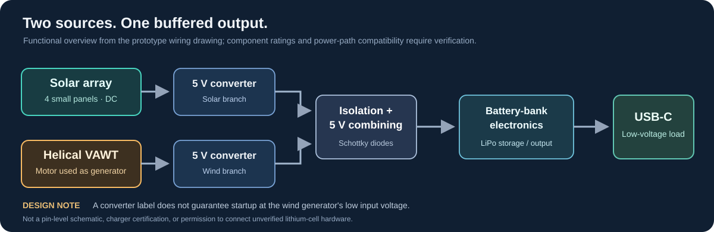

# Electrical architecture

This document records the **concept shown in the project's wiring drawing**. It is a functional description of an experimental low-voltage prototype, not a verified pin-to-pin schematic or a validated lithium-battery charging design.

## System path

The design places two energy sources in parallel at the system level, but it gives each source its own voltage-conversion path:

1. **Solar:** Four small photovoltaic modules appear in the source drawing. The project's earlier specification describes each as approximately 5 V, 200 mA nominal. The combined nameplate figure would be about 4 W under the rating conditions, **not** a measured output of the assembled system.
2. **Wind:** A helical VAWT turns a small DC motor used as a generator. The drawing labels a roughly 2–3 V wind-generator output as an example, not a constant supply.
3. **Conditioning:** Separate converters are shown for the wind and solar branches, each labeled with a 5 V target output.
4. **Source isolation:** Each converter branch passes through a Schottky diode before joining the shared input. The intent is to reduce reverse current into an inactive branch. A diode still has a forward-voltage drop and dissipates power.
5. **Storage and output:** A lithium battery / power-bank board receives the combined low-voltage input and is shown feeding a USB-C output for small devices.

The figure above deliberately keeps the battery-board pins abstract. The exact board type, charger chip, input-voltage range, protection features, battery connection and USB-C output behavior must be established from the actual component documentation before those details can be treated as finalized.

## What the wiring drawing does and does not prove

| Depicted | Not established by the drawing |
| --- | --- |
| Two renewable sources feeding a shared low-voltage system | Whether both converters can start and regulate under real conditions |
| Nominal 5 V converter outputs | Whether sufficient power remains after conversion and diode losses |
| Blocking diodes | Their current ratings, reverse-leakage characteristics and actual temperature rise |
| A battery-bank board and lithium cell | Validated charge termination, protection, fault handling and power sharing |
| USB-C connector | Negotiated output power or device compatibility |

## Important electrical limitations

**Low-input-voltage startup:** A converter labeled "5 V buck-boost" may not start from the wind generator's low-voltage output. Startup threshold, input-current draw and generator loading matter.

**Source interaction:** Diode-ORing can keep the branches from driving current back into each other, but it is not an energy-harvesting controller or maximum-power-point tracker. It also does not guarantee that a solar panel and variable-speed turbine will operate efficiently at the same time.

**Battery protection:** The presence of a lithium charge board does not by itself demonstrate a safe, compatible charger or simultaneous charging and output. A protected cell, a suitable charger with the correct chemistry/voltage, and appropriate power-path behavior are separate design checks.

**Output claims:** "5 V" on a converter label is a target voltage, not a guarantee that a phone or tablet can draw its preferred charging current continuously. Available energy depends on sunlight, wind, converter losses, and the battery's state of charge.

For assembly photos and component close-ups, see the [full illustrated guide](https://www.instructables.com/Portable-Hybrid-Rapid-Deploy-Renewable-Generator/). This repository intentionally avoids presenting an unverified pin-level battery connection as a universal build instruction.
